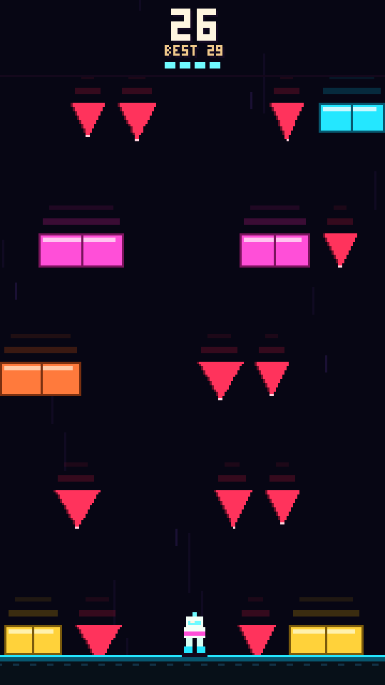

# Dash Dodge 🎮

A frantic pixel dodger by StudioRApps. Slide a tiny runner through a neon rain of blocks and spikes.

[](https://gituserc1140.github.io/dash-dodge/)
[](docs/index.html)
[](docs/styles.css)
[](docs/game.js)
[](LICENSE)
[](https://github.com/sponsors/gituserc1140)

Blocks and spikes pour down a dark lane. Drag to dodge, double-tap to dash, and skim a gap for a **CLOSE!** bonus. The rain speeds up as soon as the run begins.



# Play Now!

[](https://gituserc1140.github.io/dash-dodge/)

# Sponsor me!

[](https://github.com/sponsors/gituserc1140)

## How to Play

| Action | Mobile | Desktop |
|--------|--------|---------|
| Move | Drag / touch anywhere | Arrow keys / A D |
| Dash | Double-tap | Space |
| Restart | Tap | Click / Space |
| Mute | Tap the speaker | Click the speaker |

- The runner follows your finger. On a keyboard, hold left or right.
- Dash is a short burst with a cooldown. The four pips under **Best** fill back up when it is ready.
- Score climbs the longer you last. A near miss pops **CLOSE!** and adds a bonus.
- Blocks and spikes fall faster, and the gaps tighten, within the first seconds.
- Touch one and the run ends. Tap, click, or press Space to play again instantly.
- **Best** is remembered on this device. The speaker in the corner mutes the blips.

## Project Structure

```
/docs
  index.html    – game shell
  styles.css    – full-screen dark pixel theme
  game.js       – loop, dodge, hazards, and scoring
  gameplay.png  – gameplay screenshot
index.html      – redirects to /docs/
```

## Running Locally

Open `docs/index.html` directly in any modern browser, or serve the `/docs` folder with a local HTTP server:

```bash
# Python 3
python3 -m http.server 8080 --directory docs
# Then open http://localhost:8080
```

The root `index.html` redirects to `./docs/`, so opening the repo root works too.

## Deploy to GitHub Pages

1. Push this repository to GitHub.
2. Go to **Settings → Pages**.
3. Set **Source** to `Deploy from a branch`, branch `main`, folder `/` (root).
4. Save – GitHub Pages will publish the game at `https://gituserc1140.github.io/dash-dodge/`.

The root `index.html` automatically redirects visitors to `./docs/`, so both the root URL and the `/docs/` URL open the game.

## Technical Notes

- Pure HTML5 Canvas pixel art – no external libraries or frameworks.
- The runner, blocks, spikes, and HUD are drawn on an integer grid with smoothing off, so the pixels stay sharp.
- Falling blocks leave short trails. A dash squishes the runner, a near miss flashes the lane, and a hit shakes the screen.
- Dash, a close call, and a crash each play a short WebAudio blip. Mute is saved on this device.
- Drag, touch, arrows, and A/D move. Double-tap and Space dash. After a game over, tap, click, or Space restarts immediately.
- Touch moves call `preventDefault` so the page does not scroll or zoom while you play.
- The canvas fills a portrait playfield, inset by the device safe areas, on phones and on desktop.
- The best score is kept in `localStorage` on this device.
